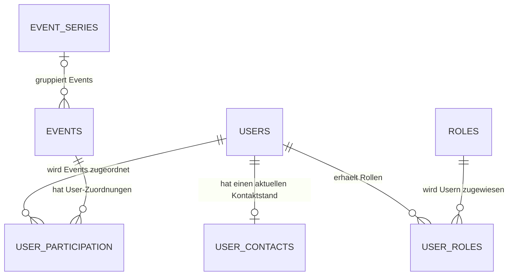

# Phase 1 · Relationales Datenmodell v1

**Fachlich freigegeben.** Grundlage für die Laravel-Migrationen auf MariaDB 11.8.

## Beziehungen

| Tabelle | Felder und Regeln |
| --- | --- |
| `users` | Interne unveränderliche BIGINT-`id`, eindeutiger `shortname`, optionale `preferred_locale` und `postal_locale`, Zeitstempel für Erstellung und Änderung. Optionale Persona-Felder `salutation`, `alias_given_name`, `alias_family_name`. Optionale Anmeldefelder `login_email` (normalisiert und eindeutig), `password_hash`, `email_verified_at`, `disabled_at` und geschützte Felder für Zwei-Faktor-Authentifizierung und Wiederherstellung. |
| `roles` | `id` und eindeutiger Rollencode `code`, zunächst `admin`. |
| `user_roles` | FKs `user_id` und `role_id` als gemeinsamer Primärschlüssel. |
| `user_contacts` | `user_id` als PK/FK. Optionale `legal_given_name`, `legal_family_name`, `contact_email`, `phone`, `contact_verified_on DATE`, `line_1`, `line_2`, `postal_code` (Text), `city`, `additional_line`, `country_code`, `allow_alias_for_post` (nullable BOOL). Höchstens ein aktueller Stand, Änderungen ersetzen die bisherigen Werte. |
| `event_series` | `id`, eindeutiger `code` und `name`. ATT hat den stabilen Code `att`. |
| `events` | Pflichtfelder `id` und `shortname`. Optionaler FK `event_series_id` und optionale `name`, `description`, `location_name`, `location_address`, `location_latitude DECIMAL(9,6)`, `location_longitude DECIMAL(9,6)`, `starts_at TIMESTAMP`, `starts_timezone`, `ends_at TIMESTAMP`, `ends_timezone`. |
| `user_participation` | `id`, Pflicht-FKs `user_id` und `event_id`, eindeutig als Paar. `invite DATE NULL DEFAULT NULL`, `rsvp DATE NULL DEFAULT NULL`, `participate BOOL NULL DEFAULT NULL`. |
| `audit_events` (Vorschlag) | Zeitpunkt, handelnder USER, Aktion, Zieltyp, interne Ziel-ID und Ergebnis. Für Import und Export Anzahl protokollieren. Vertrauliche Werte bleiben außerhalb des Auditlogs. |

USER und EVENT benötigen nur ID und Shortname. Shortnames sind 1 bis 32 ASCII-Zeichen, enthalten nach dem vorgesehenen Alphabet Buchstaben, Ziffern, Bindestriche und Unterstriche und sind je Tabelle case-insensitiv eindeutig. Die eingegebene Schreibweise bleibt sichtbar. Formulare, Import und Datenbank sichern die Regeln gemeinsam ab.

Zum Start hat nur der Betreiber einen aktiven Login und die Rolle `admin`. Weitere USER beginnen als Stammdatensätze. Login-E-Mail und Passwort-Hash sind bei Aktivierung erforderlich. Adminzugriff erfordert einen aktiven Login und die Adminrolle. Persönliche Kontaktdaten bleiben getrennt autorisierbar. Das manuell pflegbare `contact_verified_on` steht für die letzte Überprüfung. Es kann gesetzt, korrigiert oder geleert werden. Kontaktänderungen verändern das Datum nicht automatisch.

MariaDB arbeitet für Zeitpunkte mit UTC. Ein Eventzeitpunkt und seine IANA-Zeitzone sind gemeinsam gesetzt oder gemeinsam leer. Die Zone erhält die lokale Darstellung einschließlich Sommerzeit. Bei zwei gesetzten Zeitpunkten gilt Ende ≥ Start. Koordinaten kommen als geprüftes Paar.

`invite` erfasst das Einladungsdatum. `rsvp` erfasst nur das Datum einer positiven Zusage und bleibt ohne Zusage oder nach Rückzug leer. `participate` ist `true` bei Teilnahme, `false` bei ausdrücklich erfasster Nichtteilnahme und `NULL` bei offenen oder unbekannten Angaben. MariaDB sichert 0 und 1 für gesetzte Bool-Werte. Der Administrator pflegt die drei Werte unabhängig. Die erste erfasste ATT-Teilnahme ist das früheste datierte Event der Serie `att` mit `participate = true`. Undatierte Events bleiben im Verlauf sichtbar. Bei gleichem Zeitpunkt entscheidet die Event-ID.

Vorgesehene Indizes sind `user_participation(event_id, invite, user_id)`, `user_participation(user_id, participate, event_id)` und `events(event_series_id, starts_at, id)`. Restriktive Fremdschlüssel schützen die Historie. Löschung und Anonymisierung folgen einem eigenen freizugebenden Ablauf.

## Dateiaustausch

XLSX und UTF-8-CSV verwenden die freigegebenen Tabellennamen und originalen DB-Spalten. Vorgesehen sind ein XLSX-Blatt beziehungsweise eine CSV-Datei je Tabelle, Kalenderdaten als `YYYY-MM-DD`, UTC-Zeitpunkte als ISO 8601 mit `Z`, IANA-Namen in den Zonenspalten, Bool-Werte als 1 und 0 sowie SQL-`NULL` als leeres Feld. PLZ bleiben Text. Explizite Leerwerte, die bestehende Werte löschen würden, erscheinen in der Vorschau zur Bestätigung.

Der Import umfasst Personen und Kontaktdaten. Vergangene Ereignisse und Zuordnungen werden im Interface gepflegt. Anmeldefelder, Passwort-Hashes, Zwei-Faktor- und Wiederherstellungsdaten bleiben außerhalb des fachlichen Dateiaustauschs.

| Altspalte | Ziel oder Behandlung |
| --- | --- |
| Kurzname | `users.shortname` |
| Anrede, T. Vorname, T. Nachname | `users.salutation`, `users.alias_given_name`, `users.alias_family_name` |
| B. Vorname, B. Nachname, E-Mail, Telefon | `user_contacts.legal_given_name`, `legal_family_name`, `contact_email`, `phone` |
| Post, Adresse 1, Adresse 2, PLZ, Stadt, Zusatz | `user_contacts.allow_alias_for_post`, `line_1`, `line_2`, `postal_code`, `city`, `additional_line` |
| Verifiziert | `user_contacts.contact_verified_on` |
| AlumniV, Chiffre | Ausgeschlossen. Chiffre bleibt auch außerhalb der Vorschau und Fehlerberichte. |
| Latitude, Longitude | Wohnkoordinaten bleiben bis zur Zweckentscheidung in der geschützten Quelle. |

Importvorschau mit Konflikten, Zeilenzahlen und Validierung. Shortname dient als Abgleichkandidat. Bei vorhandener stabiler Quellkennung dient diese dem Wiederabgleich. Andernfalls absichern über Dateifingerabdruck, bestätigten Abgleich und protokollierte Entscheidungen. Änderungen transaktional anwenden. Der Postexport verwendet freigegebene DB-Spalten. `allow_alias_for_post` entscheidet über die Namensform. Bei fehlender Namensform, ungeklärter Post-Option oder unvollständiger Anschrift meldet die Oberfläche Prüfbedarf.
